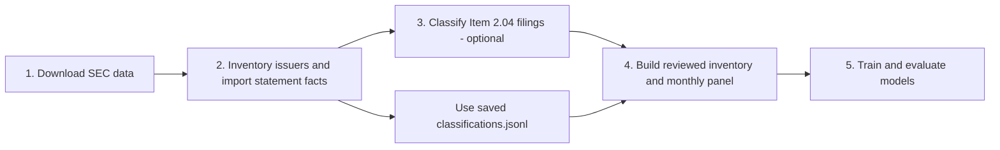

# Dynamic short-term corporate credit limits

This repository contains the thesis, SEC data pipeline, models, and credit-limit simulation for **Dynamic Determination of Short-Term Corporate Credit Limits Using Machine Learning**. See the [thesis index](docs/README.md) for chapters and the [input contracts](docs/input_contracts.md) for data requirements.

## Current study

The default target is a **bankruptcy/receivership or payment-failure disclosure within 60 days**. Item 1.03 filings qualify automatically; Item 2.04 filings require reviewed payment-failure evidence. The outcome is a disclosure proxy, not a verified contractual payment default. See the [target rules](docs/bankruptcy_payment_failure_workflow.md).

The pipeline uses local SEC filings and financial statements, builds a monthly panel with point-in-time features, and trains models with chronological validation. The [pipeline guide](docs/pipeline.md) covers options and outputs.



### Run each step

Run these commands from the repository root. Set `SEC_USER_AGENT` to your contact details. Set `OPENAI_API_KEY` only if running the optional review step. Use the same dataset and run paths throughout. The download can take substantial time and disk space; use a fresh `results/new_run` for a new study.

**1. Download SEC data** into `../dataset_full`:

```sh
export SEC_USER_AGENT="Your Name your-email@example.com"
.venv/bin/python -m mcf.workflows.pipeline download \
  --dataset ../dataset_full --output-dir results/new_run
```

Downloads SEC Company Facts, submissions, and financial statement archives.

**2. Inventory issuers and import statement facts**:

```sh
.venv/bin/python -m mcf.workflows.pipeline inventory \
  --dataset ../dataset_full --output-dir results/new_run
```

Screens eligible issuers and imports audited statement facts for their financial features.

**3. Classify Item 2.04 filings (optional)** with OpenAI Batch:

```sh
export OPENAI_API_KEY="your-key"
.venv/bin/python -m mcf.workflows.pipeline classify \
  --dataset ../dataset_full --output-dir results/new_run
```

Reviews Item 2.04 filings and records which have payment-failure evidence. The commands below use the saved Item 2.04 [classifications.jsonl](results/item_204_openai_batch_review/classifications.jsonl), so this step can be skipped. Item 1.03 disclosures are included automatically.

If you run step 3, rerun it with the same paths to collect pending Batch results, then omit `--item-204-results` from step 4 to use the new reviews.

**4. Build the reviewed inventory and monthly panel**:

```sh
.venv/bin/python -m mcf.workflows.pipeline panel \
  --dataset ../dataset_full \
  --item-204-results results/item_204_openai_batch_review/classifications.jsonl \
  --output-dir results/new_run
```

Combines reviewed disclosures with point-in-time financial features and 60-day labels.

**5. Train and evaluate models**:

```sh
.venv/bin/python -m mcf.workflows.pipeline train \
  --output-dir results/new_run
```

Tunes models chronologically and saves the selected model, metrics, and audits.

The main outputs are under `results/new_run/inventory/`, `results/new_run/panel/`, and `results/new_run/models/`. To run the pipeline with the saved classifications, use:

```sh
.venv/bin/python -m mcf.workflows.pipeline all \
  --dataset ../dataset_full \
  --item-204-results results/item_204_openai_batch_review/classifications.jsonl \
  --output-dir results/new_run
```

Use `--skip-download` with `all` if the SEC data are already present. See [reusing statement facts and reviews](docs/pipeline.md#run-everything) to avoid repeated imports or OpenAI calls. The [workflow guide](docs/workflow.md) covers reporting and the historical policy simulation.

## Historical thesis result

The preserved Item 1.03-only study used 588,111 company-months from 9,075 issuers. Its selected random forest achieved **0.9089 ROC-AUC**, **0.027475 average precision**, and **0.0020872 Brier score** on 2023–2025 held-out data. These figures describe the historical disclosure target; they are not results for the current combined target. Earlier iterations examined those years, so this is retrospective held-out evaluation.

The illustrative policy simulation had a median limit of **USD 3.79 million**. Its limits are hypothetical because the SEC data do not contain actual facilities, utilization, repayments, or losses. See the [historical results](results/history/README.md) and [reproduction workflow](docs/workflow.md).

## Repository map

| Path | Contents |
|---|---|
| `mcf/data/` | SEC extraction, labels, and monthly panel |
| `mcf/enrichment/item204/` | Filing discovery and OpenAI Batch review |
| `mcf/models/` | Training and evaluation |
| `mcf/policy/`, `mcf/reporting/` | Limit simulation and thesis reports |
| `configs/` | Study and policy settings |
| `docs/`, `results/` | Thesis guides and saved outputs |

Run the code checks with:

```sh
.venv/bin/python -m mcf.workflows.launcher -m unittest discover -s tests -v
```
