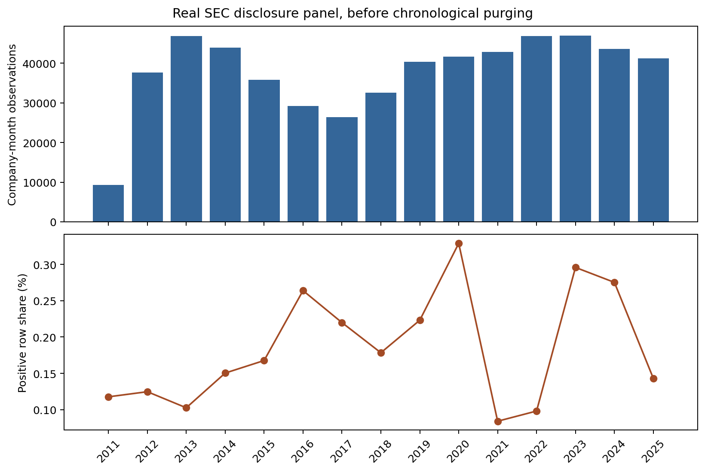
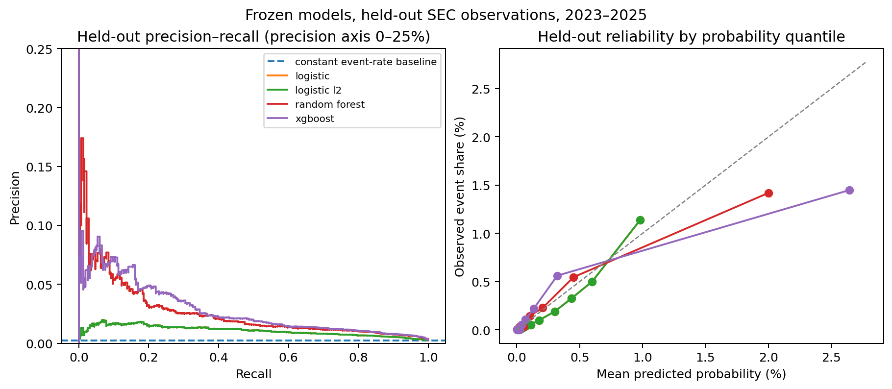

# 6 Empirical Results

Run 006 selects a random forest with its raw probability. The model ranks the defined disclosure episodes better than the logistic benchmarks and has lower selection-period Brier error than the constant benchmark. Its fixed-threshold detection remains limited.

## 6.1 Sample and Chronological Design

The labeled panel contains 565,222 company-months from 8,780 companies. It has 1,052 positive rows representing 573 disclosure episodes in 487 companies. Boundary purging removes observations whose 60-day outcome windows cross modeling stages.

| Stage | Calendar period | Observations | Positive rows | Companies | Event companies |
|---|---|---:|---:|---:|---:|
| Training | 2011–2016 | 196,174 | 294 | 5,783 | 133 |
| Tuning | 2017–2018 | 51,021 | 103 | 3,591 | 56 |
| Calibration | 2019 | 31,165 | 74 | 3,814 | 43 |
| Selection | 2020–2022 | 121,142 | 204 | 4,883 | 100 |
| Later evaluation | 2023–2025 | 131,842 | 318 | 4,633 | 165 |

The final run excludes 2023–2025 labels from fitting, tuning, calibration and selection. Earlier project versions examined these years, and the broader target was specified after that work. The evaluation is retrospective, not an untouched external validation.

*Figure 6.1. Labeled panel before chronological purging. Positive rows are monthly prediction outcomes, not separate episodes. Source: run 006 panel audit and descriptive report.*

## 6.2 Predictors and Tuning

All families use the same twelve point-in-time accounting predictors described in Chapter 3. Expanding temporal folds fit through 2016 and validate in 2017, then fit through 2017 and validate in 2018. Candidate ranking uses mean annual average-precision lift and then mean Brier skill.

The family winners are balanced logistic regression, balanced L2 logistic regression with C = 10, an unweighted random forest with 300 trees, unrestricted depth and minimum leaf size 20, and unweighted XGBoost with 200 trees, depth 4 and learning rate 0.05.

## 6.3 Probability Mapping and Selection

Sigmoid mapping lowers the logistic models' Brier errors. Raw probabilities are retained for both tree models. For the forest, the selection-period Brier score is 0.0016463 raw versus 0.0017675 after sigmoid mapping.

The constant benchmark has selection Brier score 0.0016812 and average precision equal to the 0.1684% event share. A family qualifies when its average precision exceeds that share and its Brier score is below the constant benchmark.

| Model and mapping | ROC-AUC | Average precision | Brier score | Accepted |
|---|---:|---:|---:|---|
| Logistic, sigmoid | 0.8193 | 0.006182 | 0.0017116 | No |
| L2 logistic, sigmoid | 0.8190 | 0.006168 | 0.0017116 | No |
| Random forest, raw | 0.8601 | 0.043005 | 0.0016463 | Yes |
| XGBoost, raw | 0.8755 | 0.039759 | 0.0016778 | Yes |

The forest has lower selection Brier error than XGBoost and is selected. Its frozen classification threshold is 0.057971. The credit-limit rule uses the continuous probability, not the threshold.

## 6.4 Later Evaluation

| Model | ROC-AUC | Average precision | Brier score | Precision at frozen threshold | Recall at frozen threshold |
|---|---:|---:|---:|---:|---:|
| Constant | 0.5000 | 0.002412 | 0.0024070 | 0.00% | 0.00% |
| Logistic, sigmoid | 0.8274 | 0.010678 | 0.0023953 | 1.49% | 23.27% |
| L2 logistic, sigmoid | 0.8272 | 0.010671 | 0.0023953 | 1.48% | 23.27% |
| **Random forest, raw** | **0.8866** | **0.025989** | **0.0023840** | **5.63%** | **9.12%** |
| XGBoost, raw | 0.8946 | 0.028057 | 0.0025355 | 6.21% | 6.92% |

The selected forest's average precision is 10.8 times the test event share. Its Brier score is about 0.95% below the constant benchmark. XGBoost ranks slightly better on these later observations but has higher probability error.

At the frozen threshold, the forest identifies 29 positive rows, flags 486 negative rows and misses 289 positive rows. It detects at least one monthly row for 18 of 176 test-period episodes. The 318 positive rows arise from those 176 episodes in 165 companies. This distinction matters because several monthly decisions can precede one episode.

The forest's annual ROC-AUC is 0.8715 in 2023, 0.8777 in 2024 and 0.9329 in 2025. Annual average precision is 0.02793, 0.02927 and 0.02904. Company-cluster 95% intervals for the full later period are 0.8668–0.9061 for ROC-AUC, 0.01817–0.04378 for average precision and 0.002040–0.002799 for Brier score. These intervals condition on fitted models and do not include model selection or shared time shocks.

*Figure 6.2. Precision-recall and probability diagnostics for 2023–2025. Source: run 006 model predictions and report.*

## 6.5 Statement Enrichment Comparison

Run 006 also fits the same workflow without imported statement facts on the same SEC snapshot. Both panels have identical labels and 565,222 rows. Adding statement facts fills 135,692 missing predictor cells, including 47,185 liabilities-to-assets values and 44,307 cash-flow-to-liabilities values. Fully observed rows increase from 362,979 to 398,329.

Both matched fits select random forest. Without enrichment, test ROC-AUC is 0.8797, average precision 0.02555 and Brier score 0.0023850. With enrichment, these are 0.8866, 0.02599 and 0.0023840. The paired company-cluster bootstrap gives a 95% interval of −0.00184 to 0.01545 for the ROC-AUC difference, −0.00395 to 0.00298 for average precision and −0.00000444 to 0.00000230 for Brier score. All include zero. The coverage gain is clear; these tests do not establish a reliable predictive gain.

## 6.6 Interpretation

Permutation importance for the selected forest is highest for log assets, followed by working capital to assets, asset growth and liabilities to assets. It measures model reliance, not causation. The low precision and recall at one threshold limit its use as a stand-alone alert.

The outcome combines Item 1.03 bankruptcy or receivership filings with reviewed Item 2.04 missed-payment disclosures. It does not establish the onset of a legal event or a default on the proposed facility. The results support a reproducible disclosure-risk signal and an illustrative credit policy, not measured lending performance or loss reduction.

File references: results/run_006_full_statement_enrichment/models/, model_report/, statement_enrichment_comparison.json and paired_test_comparison.json; evidence copies in docs/tables/.
