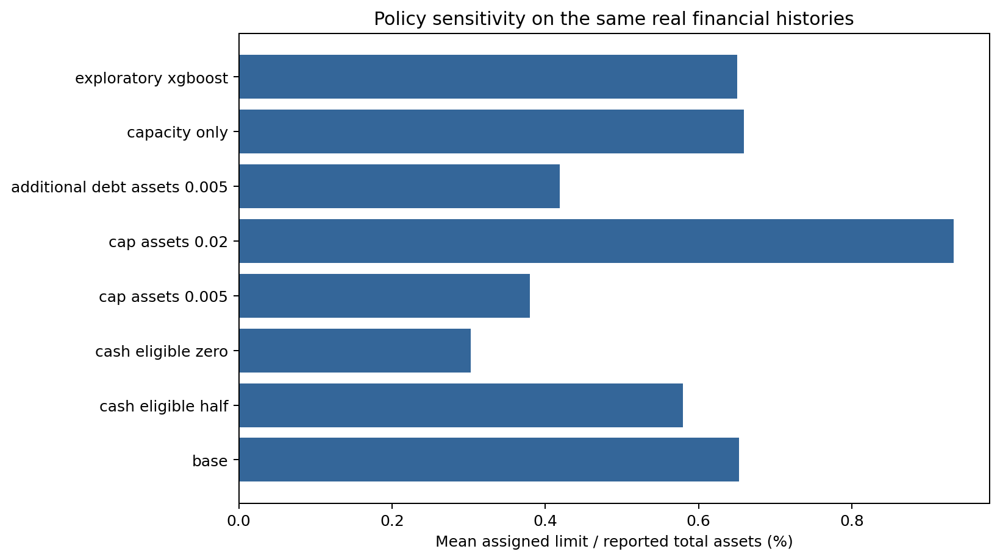

# 7 Credit-Limit Policy Results

The policy translates the selected random forest's 60-day Item 1.03 probability into a monthly credit limit. This is a historical simulation under explicit assumptions. The source data do not contain actual facility commitments, utilization, receivables, losses, pricing or profitability.

## 7.1 Policy Rule

For each eligible company-month, the raw capacity is the minimum of a cash-based amount and a sales-based amount. A monotone risk adjustment reduces that capacity as predicted disclosure risk rises. A hard exposure cap, additional debt, collateral assumptions, deadbands and phased increases then determine the implemented limit. Hard-stop conditions can reduce the limit to zero, and increases require fresh financial information.

The policy consumes a continuous probability. The frozen classification threshold is reported for model evaluation, but it is not required to calculate the credit limit. This distinction preserves information that would be lost by converting each prediction to a binary alert.

## 7.2 Base Scenario

After required-input exclusions, the base simulation covers 99,674 company-months from 3,872 companies and 5,173 continuous company segments.

| Outcome | Base result |
|---|---:|
| Mean limit | USD 53.23 million |
| Median limit | USD 3.79 million |
| Mean limit / assets | 0.653% |
| Zero-limit share | 5.69% |
| Hard-stop observations | 2,658 |
| Cap-binding share | 52.22% |
| Mean absolute monthly change / assets | 0.0285% |

Among 94,501 month-to-month transitions, 16,742 are phased increases, 9,070 are decreases and 68,689 are unchanged. The most common recorded reasons are no new information, unchanged within the deadband, phased increase, immediate reduction and hard stop. These fields make each simulated decision traceable.

*Figure 7.1. Base policy distribution and selected sensitivity scenarios. Source: policy_decisions.csv and policy_sensitivity.csv.*

## 7.3 Sensitivity

The average limit is most sensitive to assumptions that directly constrain financial capacity:

| Scenario | Mean limit / assets | Zero-limit share |
|---|---:|---:|
| Base | 0.653% | 5.69% |
| Capacity only | 0.659% | 0.00% |
| Cash rate halved | 0.579% | 5.69% |
| No cash eligibility | 0.303% | 49.66% |
| Exposure cap 0.5% | 0.380% | 5.69% |
| Exposure cap 2.0% | 0.933% | 5.69% |
| Additional debt 0.5% of assets | 0.419% | 38.05% |
| Risk sensitivity doubled | 0.645% | 5.69% |

Changing the probability model has a smaller effect on the aggregate mean under this specification: selected random forest produces 0.6527% of assets, XGBoost 0.6500%, logistic regression 0.6522% and L2 logistic regression 0.6522%. This occurs because capacity and caps bind frequently. It does not imply that the model is irrelevant for individual firms or hard-stop decisions.

The fixed initial-limit assumption exceeds contemporaneous raw capacity in 19.19% of included observations. That diagnostic is a warning against interpreting the simulation as a recommended launch portfolio.

## 7.4 Scope of the Evidence

The policy numbers are conditional outputs from an assumed rule, not observed business results. The simulation cannot estimate expected loss, profitability, approval rates, utilization or customer effects without facility-level outcomes and economics. The selected model predicts a filing event rather than contractual payment default. Accordingly, the policy chapter demonstrates how a transparent limit engine can consume a risk signal; it does not claim that the reported dollar limits are optimal or ready for production use.

File references: policy_audit.json, policy_decisions.csv, policy_sensitivity.csv, case_studies.csv, policy_report.md, empirical_policy.py and credit_policy.py.
