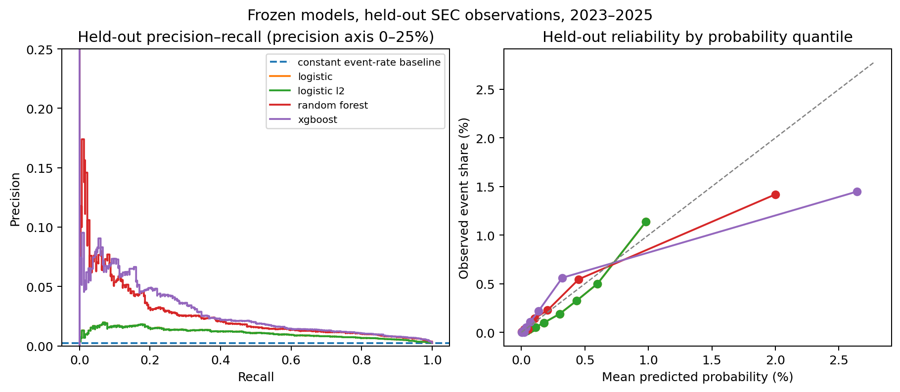

# 6 Empirical Results

The primary model experiment selects a random forest with uncorrected, or raw, probabilities. Both tree models pass the selection requirements, but the random forest has the lowest probability error during the 2020–2022 selection period. In the later 2023–2025 evaluation, it continues to rank higher-risk observations reasonably well. However, its improvement in probability error is small, and its fixed alert threshold detects only a small share of the disclosure outcomes.

## 6.1 Sample and Chronological Design

The labeled panel contains 565,222 company-months from 8,780 companies. It has 1,052 positive rows representing 573 disclosure episodes in 487 companies.

The five modeling stages contain 531,344 observations after chronological purging:

| Stage | Calendar period | Observations | Positive rows | Episodes | Companies | Event companies |
|---|---|---:|---:|---:|---:|---:|
| Training | 2011–2016 | 196,174 | 294 | 160 | 5,783 | 133 |
| Tuning | 2017–2018 | 51,021 | 103 | 58 | 3,591 | 56 |
| Calibration | 2019 | 31,165 | 74 | 45 | 3,814 | 43 |
| Selection | 2020–2022 | 121,142 | 204 | 116 | 4,883 | 100 |
| Later evaluation | 2023–2025 | 131,842 | 318 | 176 | 4,633 | 165 |

*Source: primary model experiment stage audit. Counts refer to observations retained after chronological purging.*

The stage counts are lower than the complete panel because 33,878 observations are removed at the boundaries between stages. For these observations, the complete 60-day outcome was not yet available when the next stage began. Removing them prevents future outcome information from entering an earlier modeling stage.

A **positive row** is a company-month followed by a new qualifying disclosure episode within 60 days. An **episode** is the distinct disclosure event represented by one or more positive rows. For example, a disclosure on 15 March can make both the 1 February and 1 March observations positive. This produces two positive rows but only one episode. In the later evaluation, 318 positive rows represent 176 episodes in 165 companies.

The reported experiment does not use 2023–2025 outcomes for fitting, tuning, calibration or model selection. However, these years were examined during earlier project development, and the broader outcome definition was specified after that work. The later evaluation is therefore retrospective rather than an untouched external validation.

*Figure 6.1. Labeled panel before chronological purging. Positive rows are monthly prediction outcomes, not separate episodes. Source: primary model experiment panel audit and descriptive report.*

## 6.2 Predictors and Tuning

All models use the twelve predictors defined in Chapter 3 and the chronological tuning procedure defined in Chapter 4. Tuning selects one setting within each model family:

| Model family | Selected setting |
|---|---|
| Logistic regression | Balanced class weights |
| L2 logistic regression | Balanced class weights and $$C=10$$ |
| Random forest | Unweighted, 300 trees, unrestricted depth and minimum leaf size 20 |
| XGBoost | Unweighted, 200 trees, depth 4 and learning rate 0.05 |

Balanced class weights give the rare positive rows more influence during fitting. They do not create equal numbers of positive and negative observations. Tuning selects weighting for the logistic models but not for the tree models. Appendix A records the complete parameter grid and software settings.

## 6.3 Probability Mapping and Model Selection

Sigmoid probability correction greatly reduces the logistic models' raw Brier errors, so the corrected probabilities are retained for those models. Raw probabilities are retained for both tree models. For the random forest, sigmoid correction worsens the selection-period Brier score from 0.0016463 to 0.0017675.

The constant benchmark has a selection-period event share of 0.1684% and a Brier score of 0.0016812. Average-precision lift compares average precision with that event share. Brier skill shows the percentage improvement in Brier error relative to the constant benchmark; a negative value means that the model is worse than the benchmark.

| Model and probability mapping | ROC-AUC | Average precision | AP lift | Brier score | Brier skill | Accepted |
|---|---:|---:|---:|---:|---:|---|
| Logistic, sigmoid | 0.8193 | 0.6182% | 3.67 | 0.0017116 | −1.81% | No |
| L2 logistic, sigmoid | 0.8190 | 0.6168% | 3.66 | 0.0017116 | −1.81% | No |
| Random forest, raw | 0.8601 | 4.3005% | 25.54 | 0.0016463 | 2.08% | Yes |
| XGBoost, raw | 0.8755 | 3.9759% | 23.61 | 0.0016778 | 0.20% | Yes |

Both logistic models rank positive rows above the event-share baseline, but their corrected probabilities have more Brier error than the constant benchmark. They therefore fail the requirement for improvement in both ranking and probability error. Both tree models pass. The random forest has the lower Brier score and is selected according to the rule in Section 4.9, even though XGBoost has the higher ROC-AUC.

The random forest's alert threshold is selected on the 2020–2022 period by maximizing F1. The resulting threshold is 0.057971, or approximately 5.8%. A predicted probability at or above this value produces an alert: for example, 6% produces an alert while 5% does not. The threshold is then applied unchanged to 2023–2025. It is used to evaluate alerts, not to approve credit. The credit-limit policy uses the complete continuous probability.

## 6.4 Later Evaluation

The first table reports ranking and probability quality for 2023–2025. Average precision is shown as a percentage, while AP lift compares it with the 0.2412% event share. Brier skill compares each model with the constant benchmark's Brier score of 0.0024070.

| Model | ROC-AUC | Average precision | AP lift | Brier score | Brier skill |
|---|---:|---:|---:|---:|---:|
| Constant | 0.5000 | 0.2412% | 1.00 | 0.0024070 | 0.00% |
| Logistic, sigmoid | 0.8274 | 1.0678% | 4.43 | 0.0023953 | 0.49% |
| L2 logistic, sigmoid | 0.8272 | 1.0671% | 4.42 | 0.0023953 | 0.49% |
| **Random forest, raw** | **0.8866** | **2.5989%** | **10.77** | **0.0023840** | **0.95%** |
| XGBoost, raw | 0.8946 | 2.8057% | 11.63 | 0.0025355 | −5.34% |

The next table reports performance at each model's threshold fixed during the 2020–2022 selection stage:

| Model | Precision | Recall |
|---|---:|---:|
| Constant | 0.00% | 0.00% |
| Logistic, sigmoid | 1.49% | 23.27% |
| L2 logistic, sigmoid | 1.48% | 23.27% |
| **Random forest, raw** | **5.63%** | **9.12%** |
| XGBoost, raw | 6.21% | 6.92% |

The selected forest's average precision is 10.77 times the event share. Its Brier error is about 0.95% lower than the constant benchmark, which is a positive but small improvement. XGBoost ranks slightly better, but its probability error is 5.34% higher than the benchmark. This difference shows why ranking quality and probability accuracy must be considered separately.

Across the later period, the forest's mean predicted probability is 0.284%, compared with an observed positive-row share of 0.241%. The overall Brier improvement is small, so the probability scale should not be treated as precisely validated.

At the frozen threshold, the forest creates 515 alerts. Of these, 29 are followed by a positive outcome and 486 are not. It also misses 289 of the 318 positive rows. In simple terms, approximately 6 of every 100 alerts are followed by a qualifying disclosure, while the model detects approximately 9 of every 100 positive company-months.

At the episode level, the forest produces at least one alert for 18 of 176 later-period disclosure episodes, corresponding to episode-level recall of 10.23%. Row-level and episode-level recall differ because several monthly observations can precede one episode.

The forest's annual ROC-AUC is 0.8715 in 2023, 0.8777 in 2024 and 0.9329 in 2025. Annual average precision is 2.793%, 2.927% and 2.904%, respectively. Company-cluster 95% intervals for the full later period are 0.8668–0.9061 for ROC-AUC, 1.817%–4.378% for average precision and 0.002040–0.002799 for Brier score. These intervals keep each company's observations together, but they do not include model-selection uncertainty, shared economic shocks or possible errors in the disclosure labels.

*Figure 6.2. Ranking and probability diagnostics for 2023–2025. Source: primary model experiment predictions and model report.*

## 6.5 Alternative-Period Sensitivity

The selected model changes when different chronological periods are used:

| Experiment | Tuning period | Selection period | Selected model |
|---|---|---|---|
| Primary model experiment | 2017–2018 | 2020–2022 | Random forest |
| Alternative-period sensitivity experiment | 2018 | 2023–2024 | XGBoost |

The alternative experiment also changes the training period and excludes 2020–2022 observations. Because several parts of the design change together, the different model choice cannot be attributed to one specific cause. The result instead shows that model selection is sensitive to the time periods used.

The primary selection period overlaps the COVID-19 pandemic, which may have affected company finances and disclosure patterns. However, the alternative experiment does not isolate a pandemic effect. It was also conducted after the primary results were examined. It is therefore a sensitivity check, not independent validation or a replacement for the primary design.

## 6.6 Interpretation

The selected forest relies most strongly on company size measured by log assets. Working capital to assets, asset growth and liabilities to assets are the next most influential features. This means that randomly rearranging these features causes the largest increase in the fitted model's Brier error. It does not mean that changing a feature would cause disclosure risk to change. Related features can also share information, so a low importance value does not prove that the underlying financial measure is irrelevant.

The results show useful ranking information, but they do not support using the alert threshold as a stand-alone decision rule. Most positive rows are missed, and most alerts are not followed by the recorded outcome. The continuous probability also improves only slightly on the constant benchmark's probability error.

The outcome combines Item 1.03 bankruptcy or receivership filings with reviewed Item 2.04 missed-payment disclosures. It does not establish when financial distress began or whether a company defaulted on the hypothetical facility. The results support a reproducible SEC disclosure-risk signal and an illustrative credit policy, not measured lending performance or loss reduction.
