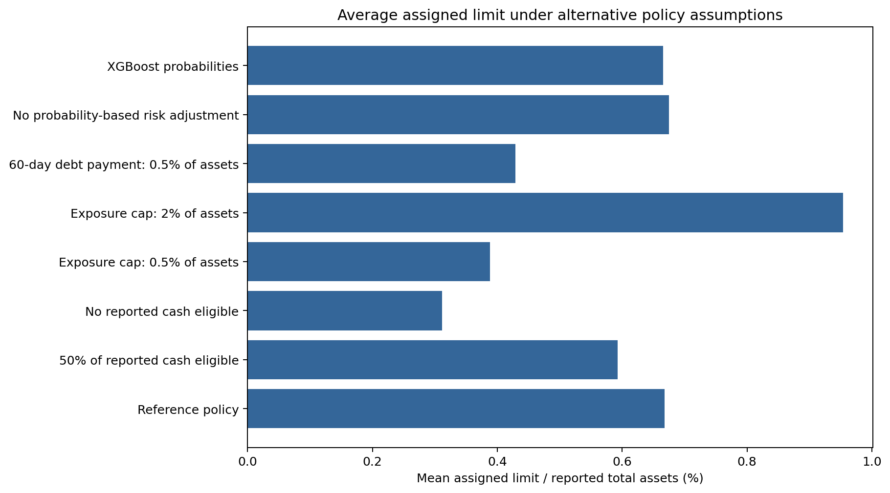

# 7 Credit-Limit Policy Results

The policy replay applies the Chapter 5 rules to historical SEC financial information from 2023–2025. It combines observed accounting values, the selected random forest's 60-day disclosure probabilities and assumptions about a hypothetical credit facility. The results show how the proposed rules behave; they are not observed lending decisions.

## 7.1 Replay Sample and Reference Assumptions

The policy replay starts with 141,460 company-months from 2023–2025. Unlike the model evaluation in Chapter 6, a policy calculation does not require a future outcome label. It requires valid financial inputs and a probability produced from information available on the decision date.

| Policy-sample step | Company-months |
|---|---:|
| Candidate financial observations | 141,460 |
| Missing required revenue, operating cash flow, cash or assets | −41,799 |
| Invalid required financial values | −42 |
| Included in the policy replay | 99,619 |

The replay therefore includes 99,619 company-months from 3,869 companies. Approximately 29.6% of the candidate rows are excluded because the monetary calculation requires revenue, operating cash flow, cash and positive assets; these values are not replaced with zero.

The included observations form 5,176 continuous company segments. A segment is a sequence of consecutive monthly observations for one company. If a month is missing, the next observation starts a new segment and is treated as a new hypothetical initial assessment. This reset is a replay convention, not evidence that a real lender would reopen a facility.

The reference, or base, scenario uses the following assumptions:

| Input or policy rule | Reference assumption |
|---|---:|
| Probability model | Selected random forest |
| Reported cash treated as eligible | 100% |
| Additional external debt payment due within 60 days | Zero |
| Maximum exposure | 1% of reported assets |
| Outstanding facility exposure | Zero |
| Risk sensitivity | $$k=10$$ |
| Increase smoothing | 50% |
| Maximum monthly increase | 10% |
| Increase deadband | 2% |

Revenue, operating cash flow, reported cash and assets come from the SEC accounting panel. Cash eligibility, near-term debt payments, the exposure cap and outstanding facility exposure are assumptions because the source data do not provide those facility-specific values. The reference scenario is a comparison point, not an optimal policy or an established lending standard.

## 7.2 Reference-Scenario Results

The reference policy produces the following results:

| Outcome | Reference result |
|---|---:|
| Mean assigned limit | USD 55.09 million |
| Median assigned limit | USD 4.23 million |
| Mean assigned limit / assets | 0.668% |
| Zero-limit share | 3.55% |
| Known-disclosure hard-stop rows | 262 |
| Preliminary limit determined by the exposure cap | 53.42% |
| Mean absolute monthly change / assets | 0.0290% |

The mean assigned limit is much higher than the median because the sample includes very large public companies. The mean is therefore affected by a small number of large monetary limits, while the median is closer to the middle company-month. Neither amount should be interpreted as a typical limit for a smaller private borrower.

The 0.668% result is the average of each company-month's assigned limit divided by its reported assets. It is not the total of all assigned limits divided by the total of all assets.

A zero limit does not always represent a new hard stop. It can result from a zero capacity proxy, a qualifying disclosure already known, or an earlier zero that cannot reopen automatically within the same segment. The 262 hard-stop rows are monthly observations, not necessarily 262 different companies or disclosure episodes.

The assumed 1%-of-assets exposure cap determines the preliminary limit in 53.42% of observations. This means that the asset cap, rather than the lower risk-adjusted capacity proxy, is the immediate upper constraint in more than half of the replay rows.

The replay contains 94,443 transitions between consecutive months within the same company segment:

| Monthly result | Transitions | Share |
|---|---:|---:|
| Increase | 17,088 | 18.09% |
| Decrease | 9,309 | 9.86% |
| No change | 68,046 | 72.05% |

Most limits remain unchanged because accounting values are carried forward between SEC reports and a new month often contains no new financial information. Missing-month gaps are not counted as monthly transitions.

## 7.3 Sensitivity to Policy Assumptions

Each sensitivity scenario uses the same historical financial observations and changes one assumption while keeping the remaining reference settings unchanged.

| Scenario | Meaning | Mean limit / assets | Zero-limit share |
|---|---|---:|---:|
| Reference policy | Assumptions listed in Section 7.1 | 0.668% | 3.55% |
| No probability-based risk adjustment | Removes the exponential reduction but retains the cap, monthly rules and hard stops | 0.675% | 3.55% |
| 50% of reported cash eligible | Treats half of reported cash as available | 0.593% | 3.55% |
| No reported cash eligible | Excludes reported cash from the capacity proxy | 0.312% | 48.30% |
| Exposure cap: 0.5% of assets | Reduces the maximum exposure from 1% to 0.5% of assets | 0.388% | 3.55% |
| Exposure cap: 2% of assets | Raises the maximum exposure from 1% to 2% of assets | 0.954% | 3.55% |
| 60-day debt payment: 0.5% of assets | Deducts an assumed near-term payment equal to 0.5% of assets | 0.429% | 36.48% |
| Stronger risk reduction, $$k=20$$ | Doubles the sensitivity of the limit to the estimated probability | 0.659% | 3.55% |

Removing the probability-based reduction raises mean limit/assets from 0.6678% to 0.6751%. The results are close but not identical. Most estimated probabilities are low, and the exposure cap already determines the preliminary limit in more than half of the observations. The risk adjustment can still produce a larger reduction for an individual company with a higher probability and a non-binding cap.

The cash and debt-payment assumptions have a stronger effect. Without eligible cash, companies with non-positive operating cash flow can have a zero capacity proxy, raising the zero-limit share to 48.30%. An assumed debt payment equal to 0.5% of assets can also exceed the capacity proxy, raising the zero-limit share to 36.48%. These results demonstrate sensitivity to unobserved facility assumptions; they do not show that companies actually have no eligible cash or owe that amount within 60 days.

Changing the exposure cap also has a large effect. A lower cap directly limits otherwise supported amounts, while a 2%-of-assets cap allows more observations to be determined by the capacity proxy. Capacity assumptions and caps therefore have a larger effect on the aggregate results than the model-based risk adjustment in these scenarios.

Using probabilities from another fitted model changes the aggregate mean little: random forest gives 0.6678% of assets, XGBoost 0.6658% and either logistic model 0.6669%. Similar averages do not mean that the models assign the same limit to every company.

*Figure 7.1. Average assigned limit as a percentage of reported assets under the reference policy and selected alternative assumptions. Each scenario uses the same historical financial observations. Source: primary model experiment policy replay.*

## 7.4 Effect of the Monthly Update Rules

Two additional benchmarks show the effect of the monthly safeguards:

| Monthly-rule version | Mean limit / assets | Mean absolute monthly change / assets |
|---|---:|---:|
| Reference policy | 0.6678% | 0.02904% |
| Keep each segment's initial limit | 0.6786% | 0.02107% |
| Apply each month's preliminary limit without smoothing | 0.7399% | 0.04227% |

The fixed-initial benchmark keeps the amount assigned at the beginning of each continuous segment, subject only to the current asset cap and a known-disclosure hard stop. It produces fewer changes, but the retained amount exceeds the current preliminary limit in 19.80% of observations. A static limit can therefore remain above the amount supported by the current calculation.

The unsmoothed benchmark applies each month's preliminary limit directly. It produces larger monthly movements and can reopen after a zero when the current preliminary limit becomes positive. The reference policy instead phases in supported increases, applies reductions immediately and requires a new initial assessment before reopening from zero within a continuous segment.

## 7.5 Scope of the Evidence

The reported limits are conditional outputs from an assumed policy. The base replay treats all reported cash as eligible, assumes no additional 60-day debt payment, sets the exposure cap to 1% of assets and assumes that the hypothetical facility has no outstanding balance. Because outstanding exposure is zero, assigned limit and available credit are equal in this replay. This would not generally be true for an operating facility with existing drawings.

A zero limit prevents additional credit under the policy but does not remove or repay an existing balance. The source data contain no actual commitments, utilization, repayments, losses, pricing, profits, approval decisions or customer effects. The model probability refers to an SEC bankruptcy or payment-failure disclosure episode, not verified default on the hypothetical facility.

The replay shows how the proposed formulas and monthly rules behave when applied to historical SEC information. It does not demonstrate that the calculated limits would reduce losses, increase profit or be suitable for actual borrowers.
